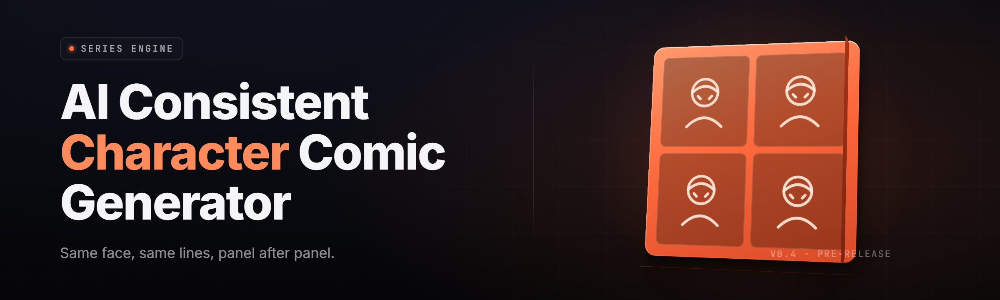

  
  
  

  

  
  

---

**One character. Forty pages. The same face on every single one.**

yo. Potato here — fridge tater, three eyes, one of them's judging your face drift. Sam pulled me out for this one because every AI comic pipeline he's touched turns his protagonist into a different cousin by page 6. comic-character-consistency-studio is the Windows .exe that locks a character's face, outfit, palette, and proportions into a reusable ID, then hammers that ID into every panel of every page. no pip. no npm. no git clone. download, extract, run the `.exe`, make comics.

---

## 📖 Table of Contents

- [Overview](#-overview)
- [What is Character Consistency?](#-what-is-character-consistency)
- [Key Features](#-key-features)
- [Quick Start](#-quick-start)
- [Module Catalog](#-module-catalog)
- [The Problem](#-the-problem)
- [The Solution](#-the-solution)
- [Installation](#-installation)
- [Tips for Best Results](#-tips-for-best-results)
- [Comparison](#-comparison)
- [Compatibility](#-compatibility)
- [System Requirements](#-system-requirements)
- [Known Issues](#-known-issues)
- [FAQ](#-faq)
- [Usage Guidelines](#-usage-guidelines)

---

## 🗂️ Overview

| Category | Details |
|---|---|
| **Product name** | comic-character-consistency-studio |
| **Niche** | AI consistent-character comic generator |
| **Version** | 2026.1.4 (stable channel) |
| **Platform** | Windows 10 / 11, x64 |
| **Distribution** | Landing page → download → extract → run the `.exe` |
| **Install path** | No Python, no Node, no git. Portable folder. |
| **Character engine** | Face-lock embedding + outfit-lock descriptor + palette pin |
| **GPU backends** | CUDA 12.x, DirectML, CPU fallback |
| **Output formats** | CBZ, PDF, PNG page stack, Webtoon vertical strip |

comic-character-consistency-studio is a desktop studio that treats a character like a saved preset instead of a prompt you re-type every panel. You train a Character ID once — a handful of reference images, one outfit sheet, a color palette, a proportion card — and the studio re-injects that ID into every generated panel. Panels that don't match get flagged by the drift checker before you waste ink on a re-roll. It's built for webtoon artists, indie comic teams, and solo creators who need forty pages that look like the same person drew them.

  

---

## 🧬 What is Character Consistency?

| Term | Explanation |
|---|---|
| **Character ID** | A saved bundle (face embed + outfit descriptor + palette + proportion card) reused across panels. |
| **Face-lock** | A reference embedding that constrains the generator so the same face survives pose, angle, and lighting changes. |
| **Outfit-lock** | A clothing descriptor that keeps jacket, seams, buttons, and wear identical panel to panel. |
| **Palette pin** | A fixed color set (skin, hair, cloth, accent) enforced at the post-gen color-pass stage. |
| **Proportion card** | Height-ratio and limb-length constraints, so the character doesn't grow or shrink between pages. |
| **Drift check** | A similarity pass that scores each panel against the Character ID and flags outliers. |
| **Panel sheet** | The export format: a grid of panels with gutters, ready for lettering or direct export to CBZ/PDF. |

Six benefits of running consistency this way:

- Your hero stops morphing into a cousin by page 6.
- Re-rolls drop because panel 1 and panel 40 share one face.
- Outfit continuity survives action poses, close-ups, and wide shots.
- Palette stays locked even when the scene lighting changes.
- Character IDs are portable — hand a `.cid` file to a collaborator.
- Export goes straight to CBZ/PDF/Webtoon without a second tool.

---

## ⭐ Key Features

| Feature | Description | Benefit |
|---|---|---|
| **Character ID Trainer** | Trains a face-lock embed from 6–20 reference images. | Reusable identity across the whole book. |
| **Face-Lock Injection** | Re-injects the ID at denoise step N of every panel. | Same face at any angle. |
| **Outfit Descriptor** | Stores garment shape, seams, and wear as a descriptor. | Clothing survives scene changes. |
| **Palette Pin Pass** | Post-gen color pass enforcing the pinned palette. | No color drift across lighting. |
| **Proportion Card** | Height/limb constraints applied per panel. | Character doesn't grow between pages. |
| **Drift Checker** | Scores each panel vs. the ID, flags outliers. | Catch bad panels before export. |
| **Panel Compositor** | Auto-gutters panels into page sheets. | No separate layout tool. |
| **CBZ / PDF Export** | One-click comic archive export. | Upload-ready in seconds. |
| **Webtoon Strip Mode** | Vertical scroll layout with spacing rules. | Native webtoon output. |
| **Scene Preset Library** | Save/load lighting + camera + mood presets. | Reuse a look across issues. |
| **Batch Panel Queue** | Queue 200 panels, walk away. | Overnight runs on a whole issue. |
| **Character Vault** | Local encrypted store of all Character IDs. | Your cast stays yours. |

---

## 🚀 Quick Start

1. 🎬 **Visit the project page** and grab the latest release archive for Windows.
2. 📦 **Extract** the archive to a folder you own (e.g. `C:\Tools\ccs`). Do not run from inside the zip.
3. ▶️ **Run the `.exe`** inside the extracted folder — the studio opens with no admin prompt needed.
4. 🧬 **Train a Character ID** from 6–20 reference images, then save it to the Character Vault.
5. 🖼️ **Generate a test page** — pick a scene preset, queue 8 panels, run the drift check, export CBZ.

---

## 🧩 Module Catalog

Thirty-one modules, grouped by domain. Each group gets a short prose pass and a module list.

### 🎭 **Character Identity Modules**
The identity stack is the reason this app exists — everything else is plumbing around keeping one face one face.

- **ID-01 Character Trainer** — builds the face-lock embed from references.
- **ID-02 Outfit Descriptor Editor** — paints and stores garment descriptors.
- **ID-03 Palette Pin** — locks skin/hair/cloth/accent colors.
- **ID-04 Proportion Card** — stores height and limb ratios.
- **ID-05 Vault Encode** — encrypts Character IDs at rest.
- **ID-06 ID Diff** — visualizes what changed between two ID versions.

### 🖌️ **Panel Generation Modules**
Generation is where the ID gets injected into every denoise pass — pose, angle, and lighting all get constrained against the trained identity.

- **GEN-01 Face-Lock Injection** — re-applies ID at denoise step N.
- **GEN-02 Pose Director** — skeleton pose control per panel.
- **GEN-03 Camera Rig** — panel framing (close-up, wide, dutch).
- **GEN-04 Expression Slider** — neutral → extreme facial ranges.
- **GEN-05 Scene Preset Library** — save/load lighting + mood.
- **GEN-06 Batch Queue** — run 200 panels unattended.
- **GEN-07 Seed Pinning** — freeze a seed for a matching panel set.

### 🎨 **Color & Style Modules**
The color stack runs after generation so lighting changes never re-color your hero's jacket.

- **CLR-01 Palette Pin Pass** — post-gen color enforcement.
- **CLR-02 Shading Preset** — flat, cel, soft, or ink style.
- **CLR-03 Line Weight Control** — per-panel line thickness.
- **CLR-04 Halftone / Screen** — print-style dithering.
- **CLR-05 Lighting Rig** — key/fill/rim presets per scene.

### 📐 **Layout & Composition Modules**
Layout turns raw panels into a readable page — gutters, reading order, and webtoon spacing all handled here.

- **LAY-01 Panel Compositor** — auto-gutter page sheets.
- **LAY-02 Reading Order Tool** — enforce left→right, top→bottom.
- **LAY-03 Webtoon Strip Mode** — vertical scroll spacing.
- **LAY-04 Bubble Placeholder** — drop lettering zones.
- **LAY-05 Page Templates** — 4-panel, 6-panel, splash, spread.

### ✅ **Quality & Drift Modules**
Drift is the enemy — the checker catches a wrong face before it reaches export.

- **QA-01 Drift Checker** — scores each panel vs. the Character ID.
- **QA-02 Outlier Highlighter** — red-tags panels below threshold.
- **QA-03 Re-Roll Queue** — one-click regenerate flagged panels.
- **QA-04 Consistency Report** — per-issue drift summary.
- **QA-05 Version Snapshot** — save a whole-issue state for rollback.

### 📤 **Export & Interop Modules**
Export ships the finished book — CBZ, PDF, PNG stacks, and webtoon strips, with metadata burned in.

- **EXP-01 CBZ Export** — comic archive with metadata.
- **EXP-02 PDF Export** — print-ready, 300dpi option.
- **EXP-03 PNG Stack** — per-panel image folder.
- **EXP-04 Webtoon Pack** — strip-format image set.
- **EXP-05 Metadata Writer** — title, author, cast, issue number.

---

## 🩹 The Problem

- Your AI-generated hero has a **different face on every page**.
- Outfit continuity **breaks the moment the pose changes**.
- Skin and hair tone **drift with scene lighting**, even in the same scene.
- The character **grows or shrinks** between close-up and wide shot.
- Re-rolling bad panels **eats the afternoon** because there's no drift signal.
- Handing a project to a **collaborator means re-teaching the identity** from scratch.
- Exporting to CBZ or Webtoon requires **a second tool** and manual gutters.

---

## 🔧 The Solution

| Problem | Solution |
|---|---|
| Different face on every page | Character ID + Face-Lock Injection at denoise step N |
| Outfit breaks on pose change | Outfit Descriptor re-applied every panel |
| Color drift with lighting | Palette Pin pass runs after generation |
| Character grows/shrinks | Proportion Card constrains height and limbs per panel |
| Re-rolls eat the afternoon | Drift Checker flags panels; Re-Roll Queue regenerates |
| Collaborator re-learns identity | Export/import `.cid` Character ID files |
| Export needs a second tool | Built-in CBZ, PDF, and Webtoon export |

---

## 💾 Installation

1. 🎬 **Visit the project page.** Grab the Windows release archive from the landing page. Do not use third-party mirrors — they may contain repacked builds.
2. 📦 **Extract.** Right-click the archive → *Extract All* → pick a folder you own, e.g. `C:\Tools\ccs`. Running from inside the archive will fail because the model cache can't write next to a compressed file.
3. ▶️ **Run.** Double-click the `.exe` in the extracted folder. The studio opens; on first launch it downloads the base model weights (~6 GB) to `%LOCALAPPDATA%\ccs\weights`. Keep the machine online for that first run only.

---

## 💡 Tips for Best Results

- Train the Character ID with **at least 12 reference images** across two angles and two expressions.
- Keep reference images the **same resolution and aspect ratio** — mixed input weakens the embed.
- Pin the **palette before your first generation**, not after — the pin pass is cheaper.
- Use **Seed Pinning** when you need panels that must look like siblings (a two-shot, a flashback).
- Run the **Drift Checker on every batch**, even when you're sure — it catches subtle page-6 face slide.
- Store Character IDs in the **Vault**, not in the project folder — the Vault survives reinstalls.
- For webtoons, generate at **vertical-friendly aspect ratios** up front; cropping after the fact breaks proportions.
- Set the **re-roll queue threshold** at 0.82 similarity — lower and you'll re-roll good panels.

---

## ⚖️ Comparison

| Aspect | Generic AI Image Tool | Prompt-Only Comic Tool | comic-character-consistency-studio |
|---|---|---|---|
| Character persistence | Prompt re-typed per image | Prompt + loose ref image | Saved Character ID, re-injected |
| Outfit continuity | Manual | Manual | Descriptor-locked |
| Palette continuity | Manual | Manual | Palette Pin pass |
| Drift detection | None | None | Built-in Drift Checker |
| Batch queue | No | Limited | 200-panel unattended queue |
| Panel gutters | External tool | External tool | Panel Compositor built-in |
| Export | PNG | PNG / loose PDF | CBZ + PDF + Webtoon |
| Collab handoff | Re-teach | Re-teach | Ship a `.cid` file |
| Install | Python/Node | Python | Portable `.exe` |

---

## 🖥️ Compatibility

| Platform | Support | Notes |
|---|---|---|
| Windows 10 x64 | ✅ Full | CUDA 12.x or DirectML |
| Windows 11 x64 | ✅ Full | Recommended |
| Windows on ARM | ⚠️ Partial | CPU fallback only, slow |
| Linux / macOS | ❌ No | Not distributed for this release |

---

## 📋 System Requirements

| Component | Minimum | Recommended |
|---|---|---|
| **OS** | Windows 10 x64 (21H2) | Windows 11 x64 |
| **CPU** | 4-core x64 | 8-core x64 |
| **RAM** | 16 GB | 32 GB |
| **GPU** | DirectML-capable, 6 GB VRAM | NVIDIA RTX 3060 12 GB+ |
| **Disk** | 20 GB free (weights + projects) | 60 GB SSD |
| **Display** | 1280×720 | 1920×1080+ |

---

## 📊 Module Status

| Module | Status | Description |
|---|---|---|
| ID-01 Character Trainer | ✅ Working | Trains face-lock embed from references |
| ID-02 Outfit Descriptor Editor | ✅ Working | Stores garment descriptors |
| ID-03 Palette Pin | ✅ Working | Locks skin/hair/cloth/accent colors |
| ID-04 Proportion Card | ✅ Working | Height/limb ratio constraint |
| GEN-01 Face-Lock Injection | ✅ Working | Re-applies ID at denoise step N |
| GEN-06 Batch Queue | ✅ Working | 200-panel unattended runs |
| CLR-01 Palette Pin Pass | ✅ Working | Post-gen color enforcement |
| LAY-01 Panel Compositor | ✅ Working | Auto-gutter page sheets |
| LAY-03 Webtoon Strip Mode | ✅ Working | Vertical scroll layout |
| QA-01 Drift Checker | ✅ Working | Panel similarity scoring |
| QA-04 Consistency Report | ✅ Working | Per-issue drift summary |
| EXP-01 CBZ Export | ✅ Working | Comic archive with metadata |
| EXP-02 PDF Export | ✅ Working | Print-ready 300dpi option |
| EXP-04 Webtoon Pack | ✅ Working | Strip-format image set |

---

## 🐛 Known Issues

| Issue | Solution |
|---|---|
| First-launch weight download stalls | Switch to a wired connection; the download resumes on retry. |
| Drift Checker flags a good panel | Raise the similarity threshold in Settings → Drift → Threshold. |
| Outfit descriptor loses fine detail at wide shots | Add a second close-up reference to the descriptor. |
| PDF export is slow on 40+ pages | Export CBZ first, then convert outside the app, or lower PDF DPI. |
| CUDA backend missing on some laptops | Fall back to DirectML in Settings → Backend. |
| Vault won't unlock after a Windows update | Re-enter the Vault passphrase; encryption is keyed to your passphrase, not the machine. |

---

## ❓ FAQ

<strong>How often does comic-character-consistency-studio update?</strong>

The stable channel ships roughly every 6–8 weeks; the build in this README is 2026.1.4. Beta builds land on the project page ahead of stable. There's no auto-updater — check the landing page.

<strong>Will this get me banned from a comic platform?</strong>

No platform bans for using a generator. Some publishers require AI-content disclosure in metadata, so read their submission rules before you upload.

<strong>Is this on Steam or a store?</strong>

No. Distribution is landing-page → download → extract → run the `.exe`. Free, MIT-licensed, no storefront.

<strong>Do I need Python or Node installed?</strong>

No. The `.exe` bundles everything. The only download on first run is the base model weights.

<strong>Can I use my own GPU model weights?</strong>

Yes — Settings → Backend → Custom Model Path. Anything in the supported architecture gets picked up and used by the Face-Lock Injection module.

<strong>How many reference images does a Character ID really need?</strong>

Six is the floor; twelve across two angles and two expressions is the sweet spot. More than twenty gives diminishing returns and slows training.

<strong>Can I share a Character ID with a collaborator?</strong>

Yes. Export the `.cid` file from the Vault and send it. Their studio imports it and the face, outfit, palette, and proportions all come along.

<strong>Does it work without a GPU?</strong>

It runs on CPU, but generation is slow — expect ~4× the time per panel and no GPU acceleration for the Face-Lock pass.

<strong>Can I sell comics made with this?</strong>

Yes. MIT license covers the software; the output is yours. Check your model weights' own licenses if you swap in custom ones.

<strong>Where are my projects stored?</strong>

Default project folder is `%USERPROFILE%\Documents\ccs-projects`. The Character Vault lives separately at `%LOCALAPPDATA%\ccs\vault` so it survives reinstalls.

---

## 📜 Usage Guidelines

| Allowed | Not allowed |
|---|---|
| Personal and commercial comics | Reselling the `.exe` as your own product |
| Webtoon, manga, indie print | Using the trademark "comic-character-consistency-studio" in a fork's name |
| Sharing `.cid` Character IDs | Bundling the base weights in a redistributed fork |
| Streaming your workflow | Removing the MIT license header from a fork |
| Modifying the source for your studio | Claiming the studio guarantees platform approval |

---

## 🗒️ Changelog (2026.1.4)

- **2026.1.4** — Drift Checker threshold now saved per-project; Webtoon Strip Mode gains spacing presets.
- **2026.1.3** — Outfit Descriptor Editor adds seam and wear brushes; Vault export is now a portable `.cid` bundle.
- **2026.1.2** — PDF export 300dpi option; DirectML backend stability fixes on Windows 11 24H2.

---

comic-character-consistency-studio exists because a comic is a promise that the person on page 1 is the person on page 40. The ID system keeps that promise, the drift checker enforces it, and the export hands you a finished book rather than a folder of near-misses. Train one character, lock the outfit, pin the palette, and let the studio grind through the panels while you write the next issue.

  

